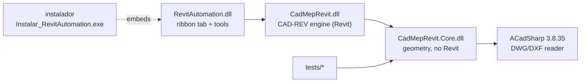
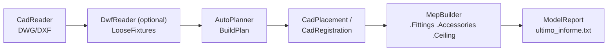

# 5. Architecture

[← Index](../../README.md) · [Español](../es/05-arquitectura.md)

## 5.1 Projects

| Project | Output | Targets | Role |
|---|---|---|---|
| `src/RevitAutomation` | `RevitAutomation.dll` | net48, net8.0-windows, net10.0-windows | `IExternalApplication` that builds the tab (`RevitAutomationApplication.cs`), ribbon icons, and the tools in `Commands/`. The CAD-REV buttons are thin subclasses in `Commands/CadRevCommands.cs`, so **every button lives in this DLL** (required by the isolated load context of Revit 2026/2027). |
| `src/CadMepRevit` | `CadMepRevit.dll` | same | CAD-REV engine with Revit: planning, placement, model building, dialogs, reports. |
| `src/CadMepRevit.Core` | `CadMepRevit.Core.dll` | net8.0, net48 | Everything that can run **without Revit**: CAD reading, layers, blocks, topology, sizes, slopes, ceiling profile. Fully testable from the console. |
| `instalador` | `Instalar_RevitAutomation.exe` | net48 WinForms | Per-user installer/uninstaller with the add-in zipped inside. |
| `tests/*` | console programs | net8.0 | See [Testing](06-testing.md). |

## 5.2 CAD-REV pipeline

1. **Read** – `CadReader` reads model space through ACadSharp: lines, polylines, arcs (as chords), blocks with their real footprint, circles, texts, dimensions and leaders. `Ocs` converts object coordinates (mirrored geometry included).
2. **Enrich** – `DwfReader` merges DWF texts aligned with the DWG; `LooseFixtures` turns line-drawn luminaires into equivalent blocks.
3. **Plan** – `AutoPlanner` creates a `BuildPlan` from the drawing, the button's scope (`ModelScope`), the defaults (`PlanDefaults`) and the project catalogue (`RevitCatalog`): geometry, sizes, systems, slopes and block associations.
4. **Place** – `CadPlacement` finds or links the CAD in the project and derives the CAD → project transform; `CadRegistration` matches line endpoints, circle centres and block insertions to check it.
5. **Build** – `MepBuilder` creates and sizes runs, places families or `DirectShape` markers, applies the ceiling rule, creates fittings in sub-transactions (rolling back any fitting that changes a pipe slope) and connects accessories and terminals.
6. **Report** – `ModelReport` reconciles the inventory (`ModelInventory`) with the result and writes the report.

## 5.3 Source map

### Core (`codigo/src/CadMepRevit.Core`)

| File | Responsibility |
|---|---|
| `BlockInfo.cs` | Oriented block footprints, exported family/type names, block roles and chamber sizes |
| `CadModel.cs` | Geometry, drawing units, CAD records, entity inventory |
| `CadReader.cs` | DWG/DXF reading (runs, blocks, circles, texts, dimensions, leaders) |
| `CadRegistration.cs` | Registration points and XY matching to estimate/check offsets |
| `CeilingProfile.cs` | Solves the ceiling-following profile of each run (steps, minimum lengths, risers) |
| `DwfReader.cs` | W2D text from DWF, aligned and merged with CAD annotations |
| `FittingNames.cs` | Recognises fitting families by name meaning (elbow, tee, cross, transition; section) |
| `LayerMapping.cs` | Classifies layers into MEP kinds; default sizes and heights |
| `LooseFixtures.cs` | Line-drawn luminaires → equivalent blocks |
| `ModelInventory.cs` | Entity accounting and cross-check of created runs |
| `ModelScope.cs` | The five scopes: allowed layers, blocks, fittings, default elevations |
| `NetworkBlocks.cs` | Network blocks: compatible run, attachment site, elevation, direction |
| `NetworkBuilder.cs` | Cleans and joins axes, splits at branches and size changes, classifies junctions |
| `NetworkComponents.cs` | Connected groups; sampling along segments |
| `NetworkGaps.cs` | Proposes/validates short same-layer extensions; records rejected gaps |
| `Ocs.cs` | DXF OCS → WCS |
| `OutlineDetector.cs` | Axes and widths from double-line outlines; fitting gaps; tray arcs |
| `PipeNetworks.cs` | Pipe service and material per network; system/type ranking |
| `PipeRisers.cs` | Vertical runs from concentric circles; levels and directions |
| `PlanDefaults.cs` | Shared defaults; layer geometry, units and network inputs |
| `SizeAnnotations.cs` | Dimensions and labels; size propagation along runs; conflicts |
| `SlopeAnnotations.cs` | Slope labels, arrows and elevation references linked to runs |
| `SlopeSolver.cs` | Flow-direction voting, node elevations, conflicts and assumptions |
| `UserRules.cs` | Unknown items and office overrides (`reglas_reconocimiento.json`) |
| `Compat/NetFrameworkCompat.cs` | .NET 8 members missing in .NET Framework 4.8 (only compiled for `net48`) |

### Revit engine (`codigo/src/CadMepRevit`)

| File | Responsibility |
|---|---|
| `App.cs` (`CadRevRibbon`) | The five CAD-REV buttons and their generated icons (does not create a tab) |
| `Commands/ModelFromCadCommand.cs` | Scoped workflow: prepare project, register CAD, group edits, report. `BuildWithoutUi` is used by Salas técnicas |
| `Commands/ImportCadCommand.cs` | Off-ribbon three-step wizard (kept) |
| `Commands/HelpCommand.cs` | Help and command availability |
| `Config/PlacementConfig.cs` | Placement rule (`sigue_techo` active; `bajo_forjado` kept, inactive) |
| `Headless.cs` | Window-less build entry point for callers with a `Document` |
| `Revit/AutoPlanner.cs` | Builds the `BuildPlan` |
| `Revit/BlockFamilies.cs` | Loads matching or generic families for blocks; records substitutions |
| `Revit/CadPlacement.cs` | Finds/links CAD; CAD → project transform |
| `Revit/CeilingFinder.cs` | Slab and ceiling undersides in the project and loaded links |
| `Revit/FamilyLibrary.cs` | Locates/loads `.rfa`; library list and cached index |
| `Revit/FittingSetup.cs` | Fills missing routing-preference fittings; maps outer diameters to nominal sizes |
| `Revit/MepBuilder*.cs` | Runs, sizes, families/markers, fittings, accessories, ceiling rule, diagnostics |
| `Revit/ModelReport.cs` | Report formatting and saving |
| `Revit/RevitCatalog.cs` | Levels, types, systems, placeable symbols, routing capabilities |
| `Revit/UnderSlabPlacer.cs` | Slab underside for the inactive `bajo_forjado` rule |
| `Ui/*.cs` | Dialogs: level picker/progress, choice list, wizard mapping and preview, unknown items, messages, help text |
| `Compat/RevitApiCompat.cs` | `RevitIds.FromValue(long)` for 32-bit `ElementId` in Revit 2023 |

### Tools (`codigo/src/RevitAutomation/Commands`)

Each tool folder follows the same pattern: `*Command.cs` (Revit entry point), `*Form.cs` / `*PreviewForm.cs` (dialogs), `*Contracts.cs` and `*Planner.cs` / `*Builder.cs` (pure logic, testable by the harnesses), `*Report.cs` and `*SettingsStore.cs` (output and settings in `Documents\RevitAutomation\<tool>`).

| Folder / file | Tool |
|---|---|
| `CadRevCommands.cs` | CAD-REV buttons (subclasses of `ModelFromCadCommand`) |
| `SalasTecnicas/` | Plant rooms |
| `Patinillo/` | Plumbing shaft |
| `Aislamiento/` | RITE insulation |
| `LlavesLocalHumedo/` | Wet-room valves |
| `PipeTagging/` | Tagging (pipes, ducts, trays, families, luminaires) |
| `Planos/` | Sheets and views |
| `PdfExportCommand.cs`, `PdfFilePublication.cs`, `CadExportCommand.cs`, `ExportPathSupport.cs` | PDF and CAD export |
| `Regiones/` | Fire-compartment regions |

## 5.4 Multi-version support

- **Revit 2023/2024 (`net48`)**: code is written against .NET 8. `NetFrameworkCompat.cs` supplies missing BCL members (`Math.Clamp`, `double.IsFinite`, `MinBy`, `GetValueOrDefault`, `Path.GetRelativePath`, `ProcessStartInfo.ArgumentList`…) with C# 14 extension members; PolySharp supplies language attributes; `System.Text.Json` comes from NuGet. `RevitAutomationApplication` resolves bundled DLLs from its own folder because .NET Framework add-ins have no binding redirects.
- **Revit 2026/2027**: the manifest loads the add-in in an isolated context, so ACadSharp cannot clash with other add-ins.
- Conditional code can use the `REVIT<year>` constants and `NETFRAMEWORK`.

## 5.5 Design principles

- One ribbon click = one `TransactionGroup` = one Ctrl+Z.
- Every fitting and accessory insertion runs in its own sub-transaction and is rolled back on failure, leaving the placed family and a report entry.
- Nothing is invented: unknown values are `SUPUESTO` and reported.
- Logic that does not need Revit lives in Core so it can be tested outside Revit.
