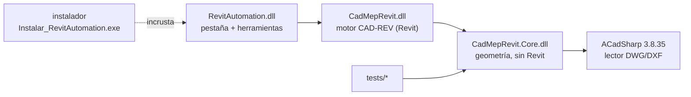
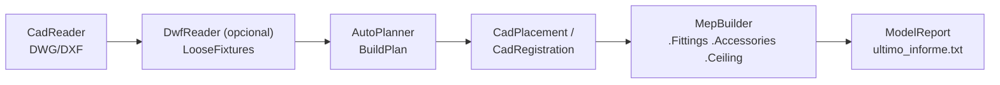

# 5. Arquitectura

[← Índice](../../README.es.md) · [English](../en/05-architecture.md)

## 5.1 Proyectos

| Proyecto | Resultado | Plataformas | Función |
|---|---|---|---|
| `src/RevitAutomation` | `RevitAutomation.dll` | net48, net8.0-windows, net10.0-windows | `IExternalApplication` que crea la pestaña (`RevitAutomationApplication.cs`), los iconos y las herramientas de `Commands/`. Los botones de CAD-REV son subclases mínimas en `Commands/CadRevCommands.cs`, así que **todos los botones están en este DLL** (lo exige el contexto de carga aislado de Revit 2026/2027). |
| `src/CadMepRevit` | `CadMepRevit.dll` | las mismas | Motor CAD-REV con Revit: planificación, colocación, construcción del modelo, ventanas e informes. |
| `src/CadMepRevit.Core` | `CadMepRevit.Core.dll` | net8.0, net48 | Todo lo que funciona **sin Revit**: lectura CAD, capas, bloques, topología, medidas, pendientes y perfil del techo. Se prueba entero desde la consola. |
| `instalador` | `Instalar_RevitAutomation.exe` | net48 WinForms | Instalador y desinstalador por usuario, con el complemento comprimido dentro. |
| `tests/*` | programas de consola | net8.0 | Vea [Pruebas](06-pruebas.md). |

## 5.2 Flujo de CAD-REV

1. **Leer** – `CadReader` lee el espacio modelo con ACadSharp: líneas, polilíneas, arcos (en cuerdas), bloques con su huella real, círculos, textos, cotas y directrices. `Ocs` convierte las coordenadas de objeto (también la geometría reflejada).
2. **Completar** – `DwfReader` suma los textos del DWF alineados con el DWG; `LooseFixtures` convierte las luminarias dibujadas con líneas en bloques equivalentes.
3. **Planificar** – `AutoPlanner` crea un `BuildPlan` a partir del plano, el alcance del botón (`ModelScope`), los valores por defecto (`PlanDefaults`) y el catálogo del proyecto (`RevitCatalog`): geometría, medidas, sistemas, pendientes y asociación de bloques.
4. **Situar** – `CadPlacement` encuentra o vincula el CAD en el proyecto y calcula la transformación CAD → proyecto; `CadRegistration` la comprueba comparando extremos de líneas, centros de círculos e inserciones de bloques.
5. **Construir** – `MepBuilder` crea y dimensiona los tramos, coloca familias o marcadores `DirectShape`, aplica la regla del techo, crea las uniones en subtransacciones (deshaciendo la que cambie la pendiente de un tubo) y conecta accesorios y terminales.
6. **Informar** – `ModelReport` cuadra el inventario (`ModelInventory`) con el resultado y escribe el informe.

## 5.3 Mapa del código

### Núcleo (`codigo/src/CadMepRevit.Core`)

| Archivo | Responsabilidad |
|---|---|
| `BlockInfo.cs` | Huella orientada de los bloques, nombres de familia/tipo exportados, función del bloque y medidas de arquetas |
| `CadModel.cs` | Geometría, unidades del dibujo, registros CAD e inventario de entidades |
| `CadReader.cs` | Lectura DWG/DXF (tramos, bloques, círculos, textos, cotas, directrices) |
| `CadRegistration.cs` | Puntos de encaje y comparación XY para estimar y comprobar desplazamientos |
| `CeilingProfile.cs` | Resuelve el perfil «sigue el techo» de cada tramo (escalones, longitudes mínimas, subidas) |
| `DwfReader.cs` | Textos W2D del DWF, alineados y sumados a las anotaciones del CAD |
| `FittingNames.cs` | Reconoce familias de unión por el significado del nombre (codo, te, cruz, transición; sección) |
| `LayerMapping.cs` | Clasifica las capas en tipos MEP; medidas y alturas por defecto |
| `LooseFixtures.cs` | Luminarias dibujadas con líneas → bloques equivalentes |
| `ModelInventory.cs` | Cuenta de entidades y contraste de los tramos creados |
| `ModelScope.cs` | Los cinco alcances: capas, bloques y uniones permitidos, cotas por defecto |
| `NetworkBlocks.cs` | Bloques de red: tramo compatible, punto de unión, cota y dirección |
| `NetworkBuilder.cs` | Limpia y une ejes, parte en ramales y cambios de medida, clasifica los encuentros |
| `NetworkComponents.cs` | Grupos conectados; muestreo a lo largo de segmentos |
| `NetworkGaps.cs` | Propone y valida prolongaciones cortas en la misma capa; anota los huecos rechazados |
| `Ocs.cs` | OCS → WCS del DXF |
| `OutlineDetector.cs` | Ejes y anchos desde contornos a doble línea; huecos de piezas; arcos de bandeja |
| `PipeNetworks.cs` | Servicio y material de cada red de tubería; orden de sistemas y tipos |
| `PipeRisers.cs` | Tramos verticales desde círculos concéntricos; niveles y sentidos |
| `PlanDefaults.cs` | Valores por defecto comunes; geometría por capa, unidades y datos de red |
| `SizeAnnotations.cs` | Cotas y rótulos; propagación de medidas por el recorrido; conflictos |
| `SlopeAnnotations.cs` | Rótulos de pendiente, flechas y cotas de referencia asociados a los tramos |
| `SlopeSolver.cs` | Votación del sentido de flujo, cotas en los nudos, conflictos y supuestos |
| `UserRules.cs` | Elementos desconocidos y reglas de la oficina (`reglas_reconocimiento.json`) |
| `Compat/NetFrameworkCompat.cs` | Miembros de .NET 8 que faltan en .NET Framework 4.8 (solo se compila en `net48`) |

### Motor con Revit (`codigo/src/CadMepRevit`)

| Archivo | Responsabilidad |
|---|---|
| `App.cs` (`CadRevRibbon`) | Los cinco botones de CAD-REV y sus iconos generados (no crea pestaña) |
| `Commands/ModelFromCadCommand.cs` | Flujo por alcance: prepara el proyecto, encaja el CAD, agrupa los cambios, informa. `BuildWithoutUi` lo usan las Salas técnicas |
| `Commands/ImportCadCommand.cs` | Asistente de tres pasos, fuera de la cinta (se conserva) |
| `Commands/HelpCommand.cs` | Ayuda y disponibilidad de los comandos |
| `Config/PlacementConfig.cs` | Regla de colocación (`sigue_techo` activa; `bajo_forjado` se conserva desactivada) |
| `Headless.cs` | Punto de entrada sin ventanas para quien tenga un `Document` |
| `Revit/AutoPlanner.cs` | Construye el `BuildPlan` |
| `Revit/BlockFamilies.cs` | Carga la familia del bloque o una genérica; anota las sustituciones |
| `Revit/CadPlacement.cs` | Encuentra o vincula el CAD; transformación CAD → proyecto |
| `Revit/CeilingFinder.cs` | Caras inferiores de forjados y falsos techos del proyecto y de los vínculos |
| `Revit/FamilyLibrary.cs` | Busca y carga `.rfa`; lista de bibliotecas e índice en caché |
| `Revit/FittingSetup.cs` | Completa las uniones de las preferencias de enrutamiento; pasa diámetros exteriores a nominales |
| `Revit/MepBuilder*.cs` | Tramos, medidas, familias/marcadores, uniones, accesorios, regla del techo y diagnóstico |
| `Revit/ModelReport.cs` | Formato y guardado del informe |
| `Revit/RevitCatalog.cs` | Niveles, tipos, sistemas, símbolos colocables y capacidades de enrutamiento |
| `Revit/UnderSlabPlacer.cs` | Cara inferior del forjado para la regla `bajo_forjado` (desactivada) |
| `Ui/*.cs` | Ventanas: nivel y progreso, lista de opciones, mapeo y previsualización del asistente, elementos desconocidos, mensajes, ayuda |
| `Compat/RevitApiCompat.cs` | `RevitIds.FromValue(long)` para el `ElementId` de 32 bits de Revit 2023 |

### Herramientas (`codigo/src/RevitAutomation/Commands`)

Cada carpeta sigue el mismo patrón: `*Command.cs` (entrada desde Revit), `*Form.cs` / `*PreviewForm.cs` (ventanas), `*Contracts.cs` y `*Planner.cs` / `*Builder.cs` (lógica pura, la que prueban los harness), `*Report.cs` y `*SettingsStore.cs` (informes y ajustes en `Documentos\RevitAutomation\<herramienta>`).

| Carpeta / archivo | Herramienta |
|---|---|
| `CadRevCommands.cs` | Botones de CAD-REV (subclases de `ModelFromCadCommand`) |
| `SalasTecnicas/` | Salas técnicas |
| `Patinillo/` | Patinillo de fontanería |
| `Aislamiento/` | Aislamiento RITE |
| `LlavesLocalHumedo/` | Llaves de local húmedo |
| `PipeTagging/` | Etiquetado (tuberías, conductos, bandejas, familias, luminarias) |
| `Planos/` | Planos y vistas |
| `PdfExportCommand.cs`, `PdfFilePublication.cs`, `CadExportCommand.cs`, `ExportPathSupport.cs` | Exportar PDF y CAD |
| `Regiones/` | Región de sectorización |

## 5.4 Varias versiones de Revit

- **Revit 2023/2024 (`net48`)**: el código se escribe para .NET 8. `NetFrameworkCompat.cs` aporta los miembros de la BCL que faltan (`Math.Clamp`, `double.IsFinite`, `MinBy`, `GetValueOrDefault`, `Path.GetRelativePath`, `ProcessStartInfo.ArgumentList`…) con miembros de extensión de C# 14; PolySharp aporta los atributos del lenguaje; `System.Text.Json` viene de NuGet. `RevitAutomationApplication` resuelve las DLL que lo acompañan desde su propia carpeta, porque en .NET Framework los complementos no tienen redirecciones de ensamblados.
- **Revit 2026/2027**: el manifiesto carga el complemento en un contexto aislado, así ACadSharp no choca con otros complementos.
- El código condicional puede usar las constantes `REVIT<año>` y `NETFRAMEWORK`.

## 5.5 Principios de diseño

- Un clic en la cinta = un `TransactionGroup` = un Ctrl+Z.
- Cada unión y accesorio se inserta en su propia subtransacción y se deshace si falla, dejando la familia colocada y una línea en el informe.
- No se inventa nada: los valores desconocidos son `SUPUESTO` y se informan.
- La lógica que no necesita Revit está en el núcleo para poder probarla fuera de Revit.
